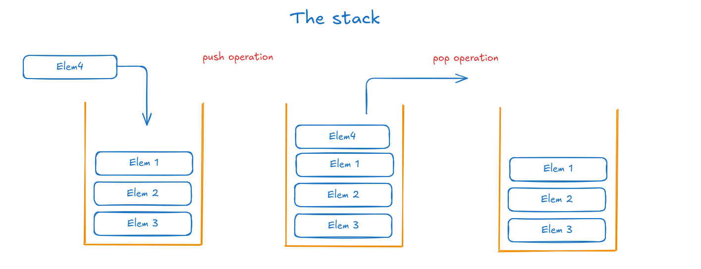
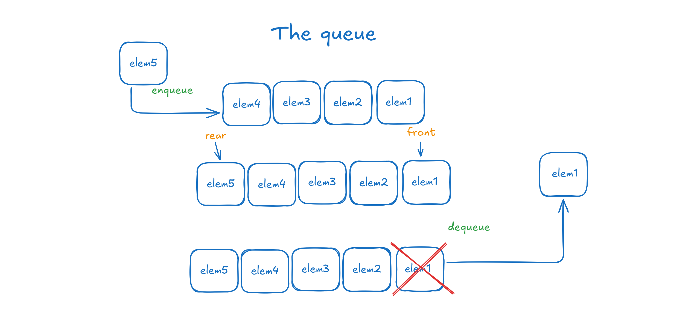

import CollapsibleElement from '../../Components/Blog_Components/CollapsibleElement.astro';
import ComplexityComponent from '../../Components/Blog_Components/ComplexityComponent.astro'

# Stack

## Quick recap - what is the stack

A stack is a data structure that follows the LIFO principle - Last in, First out. In order to implement the structure, 
we can use a vector for maximum time efficiency or a linked list for maximum space efficiency. The stack has two
operations: inserting an element on top (it is called the **push operation**) and deleting the last element that was inserted (called
 the **pop** operation).



<ComplexityComponent 
  title="Time complexity for common operations of the stack"
  operations={[
    { name: "Push", complexity: "O(1)" },
    { name: "Pop", complexity: "O(1)" },
    { name: "Top", complexity: "O(1)" },
  ]}
/>

### Revision - implementing the stack in C
<CollapsibleElement summary="See code">
```c
    typedef struct Stack
    {
        int *data;
        int capacity, top;
    } Stack;

    // init the structure
    Stack *initStack(int capacity)
    {
        Stack *s = malloc(sizeof(Stack));
        s->capacity = capacity;
        s->top = -1;
        s->data = malloc(s->capacity * sizeof(int));
        return s;
    }

    // is empty
    int isStackEmpty(Stack *s)
    {
        return s->top == -1;
    }

    // push - inserting an element as the last
    void push(Stack *s, int elem)
    {
        if (s->top == s->capacity - 1)
            return; // not enough space on the stack

        s->top++;
        s->data[s->top] = elem;
    }

    // pop - deleting the last element
    int pop(Stack *s)
    {
        if (s->top == -1)  // stack is already empty
            return -99999; // or other err code

        int val = s->data[s->top];
        s->top--;
        return val;
    }
```
</CollapsibleElement>


## The stack in STL

In the Standard Template library the stack is implemented as a container adaptor, meaning that under the hood it uses the std::deque container
and it restricts its interface in order to enforce LIFO. We use the ```<stack>``` header which provides functions such as 
*push*, *pop*, *top*, *empty* and *size*.

### Declaration & Initialization

In order to initialize the stack at declaration we need to initialize the underlying container which is **std::deque**.

```cpp
#include <stack>
#include <deque>
#include <list>

// stack<type> name_of_stack;

// examples:
std::stack<int> myStack;
std::stack<std::pair<int, char>> new_stack;
std::stack<int, std::list<int>> listStack;

// initialize
std::stack<char> s(std::deque<char>{'a', 'b', 'c'}); // a is the bottom, c is the top
```

### Inserting and accessing elements

We can only insert elements at the top using the **push** method, while we can access only the last element using the **top** method.

```cpp
#include <stack>
#include <iostream>
std::stack<int> s;

s.push(40);
s.push(50);
s.push(60);
std::cout << s.top(); // 60

```

### Deleting elements and checking if the stack is empty

The stack only allows to remove the top element using the **pop** function, while checking using the **empty** method if 
the stack has an element or not.

```cpp
#include <deque>
#include <stack>
#include <iostream>

std::stack<char> s(std::deque<char>{'a', 'b'});

s.pop();
std::cout << s.top(); // a 
s.pop();
if(s.empty())
    std::cout << "empty"; // true

```

### Traversing and finding size

We can only traverse the stack by deleting element by element or by creating a copy of it where we do the same procedure.

```cpp
#include <stack>
#include <deque>
#include <iostream>

std::stack<int> s(std::deque<int> {1, 2, 3, 4});

cout << s.size() << std::endl; // 4

std::stack<int> temp(s); // making a copy

while(!temp.empty()){
    std::cout << temp.top() << ' ';
    temp.pop();
} // 4 3 2 1
```

### Other useful methods

    - **stack1.swap(stack2)** - efficiently exchanges the contents of the two stacks
    - **stack.emplace(element)** - While push() copies or moves an existing object into the stack, emplace() constructs the object in-place directly inside the container

--- 

# Queue

## Quick recap - what is the queue

The queue is a data structure that functions by the FIFO principle - **First in, First out**. It can be implemented dynamically using a linked list, or 
statically by using a vector. 

When implemented dynamically, the **head of the linked list** corresponds to the **front
of the queue**, while the tail of the list corresponds to the back of the queue in order
to allow O(1) deletions.

Likewise the stack, it implements three operations: **enqueue** (adding an element to the queue as the last), 
**dequeue** (eliminating the first element in the queue) and **peek** (getting the value of the first element).



<ComplexityComponent 
  title="Time complexity for common operations of the queue"
  operations={[
    { name: "Enqueue", complexity: "O(1)" },
    { name: "Dequeue", complexity: "O(1)" },
    { name: "Peek", complexity: "O(1)" },
  ]}
/>

### Revision - implementing the queue in C
<CollapsibleElement summary="See code">
```c
#include <stdio.h>
#include <stdlib.h>

typedef struct QueueCell
{
    void *data;
    struct QueueCell *next;
} QueueCell;

typedef struct Queue
{
    QueueCell *front, *rear;
} Queue;

Queue *initQueue()
{
    Queue *q = malloc(sizeof(Queue));
    q->front = q->rear = NULL; // initially no elements in the queue

    return q;
}

// adds the element at the rear
void enqueue(Queue *q, void *data)
{
    QueueCell *newCell = malloc(sizeof(QueueCell));
    newCell->data = data;
    newCell->next = NULL;

    if (q->rear == NULL)
    { // adding the first element
        q->front = q->rear = newCell;
    }
    else
    {
        q->rear->next = newCell;
        q->rear = newCell;
    }
}

// returns the value of the only accesible element - the first
void *peek(Queue *q)
{
    if (!q->front)
        return NULL;
    return q->front->data;
}

// eliminates the first element
void dequeue(Queue *q)
{
    // the queue is empty
    if (!q->front)
        return;

    QueueCell *cell = q->front;
    if (q->front == q->rear)
    {
        q->rear = q->front = NULL;
    }
    else
    {
        q->front = q->front->next;
    }
    free(cell);
}    
```
</CollapsibleElement>

## The queue in STL

Likewise the stack, the queue is also implemented as a container adapter over std::deque.
We use the queue by including ```<queue>``` header which implement functions such as
**push** (enqueue), **pop** (dequeue), **empty**.

### Declaration  & Initialization

In order to initialize the queue at declaration, we need to initialize the underlying
container, which is std::deque. 

```cpp 
// Initialization structure
std::queue<element_type> queue_name;

// examples
std::queue<int> q1;
std::queue<std::pair<int, char>> pairQueue;
std::queue<int, std::list<int>> listQueue;

// Initialization
std::queue<int> q2(std::deque<int>{10, 20, 30}); // 10 is front, 30 rear
```
### Inserting and accessing elements

Because of the FIFO principle, we can only add at the back using the
**push** method, while we can access the first element (using **front**) and the last (using **back**).

```cpp
std::queue<int> q;

q.push(40);
q.push(50);
q.push(60);

std::cout << q.front();     // 40
std::cout << q.back();      // 60
```

### Deleting elements and checking emptiness

The queue only allows to delete the first element using the **pop** method, while
checking if the queue is empty using the function with the same name.

```cpp 
std::queue<char> q(std::deque<char>{'a', 'b', 'c'});

q.pop(); // eliminate 'a'
std::cout << q.front(); // 'b'

q.empty(); // false
```

### Traversing and finding size

We can only traverse the queue by deleting element by element (or creating a copy and doing
the same procedure).

```cpp
std::queue<int> q(std::deque<int> {1, 2, 3, 4, 5});

// finding size
std::cout << q.size(); // 5

// traversing
std::queue<int> cpyQ(q); // making a copy

while(!cpyQ.empty()){
    // using g.front();
    cpyQ.pop();
}
```

### Other useful methods

- **queue1.swap(queue2)** - exchanges the contents of the two queues
- **queue.emplace(element)** - while **push()** copies or moves an existing object into the queue, **emplace()** constructs the object in-place directly at the back of the underlying container.
