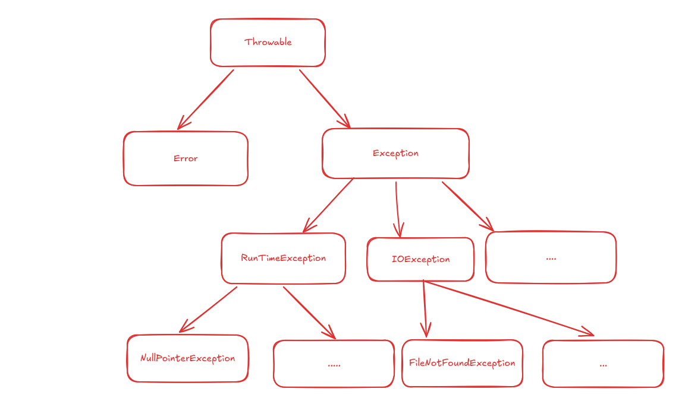

import CollapsibleElement from '../../Components/Blog_Components/CollapsibleElement.astro';

## What are exceptions

An **exception** is an *exceptional event* that disrupts the normal execution flow of a program.
The lifetime of an exception involves three steps:

* **Throwing an exception** – signaling that an error occurred

* **Catching an exception** – intercepting the error signal

* **Exception handling** – executing the code block designed to resolve/log the problem

When an exception occurs, the **JVM** creates an *exception object* on the *heap* containing a snapshot of the *active call stack* and searches backward through active methods for a matching handler. If no handler is found in `main`, the JVM's default exception handler prints the stack trace to `stderr` and terminates the execution of the thread.

## Types of exceptions

In Java, there are two types of exceptions based on how the compiler enforces error handling — **checked** and **unchecked** exceptions.

### Checked exceptions

These represent *anticipated, often recoverable problems* that usually originate from outside the program's immediate control (*e.g.*, missing files, network interruptions). The Java compiler actively checks for these during compilation.

**Enforcement** – If a method contains code that might generate checked exceptions, it is *strictly constrained* to handle them; otherwise, the code fails to compile.

### Unchecked exceptions

Typically represent *programming flaws*, *logic bugs*, or *improper API usage* that should be fixed in the code rather than caught at runtime. The compiler ignores them.

**Enforcement** – The compiler does not force handling them; code containing unchecked exceptions will compile perfectly, but will result in runtime crashes.

## Advantages of Exception Handling

1. **Code separation** – isolating normal *business logic* from *error-handling logic*.

2. **Error propagation** – automatically passing errors up the *call stack* across multiple method calls without manual status checks at every layer.

3. **Grouping errors** – using *class inheritance* so a single `catch` block can intercept an entire family of related exceptions.

---

## Catching and Handling exceptions

In Java, error handling is not optional; it's a **constraint**. We can handle exceptions in two places:

* **In the callee** – in the function that executes the code that may throw exceptions

* **In the caller** – the place in the code that uses the function must treat the exceptions too

> **Important:**
> We can combine both strategies — some exceptions are handled in the *callee*, while others are handled by the *caller*.

### Handling exceptions in the callee

It means handling the exception in the function where the instructions that may generate it are located. It is intercepted and resolved using the `try - catch - finally` structure, where:

* `try` – encloses instructions that might generate exceptions.

* `catch` – intercepts and handles a specific exception type if thrown inside the `try` block.

* `finally` – contains *cleanup code* that is guaranteed to execute regardless of whether an exception was thrown or not. It almost always runs (even if there is a `return` statement inside `try`), except if the JVM shuts down abruptly.

#### Example - opening and reading a file

In the code snippet below, we open a file and we want to treat different exceptions such as: *file not found* or *file cannot be closed*, etc.
We treat these cases using `try-catch` blocks.

```java
public static void readFile(String fileName) {
    FileReader f = null;
    try {
        // opening file
        f = new FileReader(fileName);
        // reading and printing character by character
        int c;
        while ( (c = f.read()) != -1 )
            System.out.print((char) c);
    } catch (FileNotFoundException e) {
        // we treat the case that the file doesn't exist
        System.err.println("The file doesn't exist");
    } catch (IOException e) {
        // treating other IO errors
        System.out.println("Reading error");
        e.printStackTrace();
    } finally {
        if (f != null) // closing file
            try {
                f.close();
            } catch (IOException e) {
                // we treat the case that the file cannot be closed
                System.err.println("File cannot be closed");
                e.printStackTrace();
            }
    }
}

```

### Letting the caller handle exceptions

We can delegate handling exceptions to the *caller* by declaring the `throws` clause in its header as such:

```
[modifiers] methodName ([arguments]) throws Exception1, ... {}

```

A method can omit `catch` blocks (because it delegates error handling via `throws`) while still using `try-finally` for *resource cleanup*.

The `throws` keyword appears in the **method signature** (it is a *declarative keyword*), while the `throw` instruction (*imperative statement*) is used inside the **method body** to explicitly generate or re-throw exception objects.

#### Example - adapting the code from the previous example

The code from the previous example handles all the errors inside the function. We can force the *caller* to handle them using `throws`.

```java
public static void readFile(String fileName) 
    throws FileNotFoundException, IOException {
        FileReader f = null;
        try {
            f = new FileReader(fileName);
            int c;
            while ( (c = f.read()) != -1 )
                System.out.print((char) c);
        } finally {
            if (f != null)
                f.close();
        }
}

// in the caller:
    try {
        readFile("File name");
    } catch (FileNotFoundException e) {
        // treating error
    } catch (IOException e) {
        // treating error two
    }

```

> **Takeaways:** From this code snippet we can draw different conclusions:
>
> 1. We can nest `try-catch` statements (even in the `finally` block).
>
> 2. The exception object provides different error data such as the *stack trace*.

---

## Throwing exceptions

Until now, we saw how exceptions were thrown *implicitly* — either the **JVM** generated them or a **standard library** did.

The programmer can *explicitly* throw exceptions using the `throw` instruction, which requires an **object instance** from a class in the `Throwable` hierarchy. Therefore, `throw` must always be followed by an *instance* of an exception class (either created with the `new` operator or an existing variable from a `catch` block).

The exact moment the JVM executes a `throw` statement, normal sequential execution stops. The JVM immediately begins searching for a matching `catch` block (first *locally*, then *up the stack*).

### Examples:

```java
// case I - throwing a checked exception with a custom message
throw new IOException("Exception error - printed via e.getMessage() or e.printStackTrace()");

// case II - guard clauses & throwing an unchecked exception
if (index > vector.length)
    throw new ArrayIndexOutOfBoundsException();

// case III - catching and re-throwing an exception
catch (Exception e) {
    System.out.println("Exception appeared");
    throw e;
}

```

> **Important:**
> Because `throw` immediately exits the current execution block, placing any line of code directly after an unconditional `throw` statement inside the same block will cause a compile-time error (`Unreachable statement`).

## Exception class hierarchy

All exception and error types in Java inherit from the root class `Throwable`. 



This superclass branches into two direct subclasses:

* `Error` – represents *severe system/JVM failures*

* `Exception` – represents *software exceptions* that applications can handle (subclasses include `RuntimeException`, `IOException`, etc.)

Every exception inherits three key **diagnostic methods**: `getMessage()` (returns only the *descriptive error string*), `toString()` (returns the *full class name* followed by a colon and `getMessage()`), and `printStackTrace()` (prints the output of `toString()` plus the *exact sequence of method calls*, *file names*, and *line numbers* leading to the error).

### Arithmetic Exception

Dividing by `0` will generate an `ArithmeticException` **only** if the numbers are *integer types* (`int`, `long`, etc.). In the case of *floating-point types* (`float`, `double`), it will **not** generate an exception; instead, it will return either `+/-Infinity` or `NaN` (in the case of `0/0`).

## Creating custom exceptions

The programmer can create *custom exceptions* by extending the `Exception` class:

```java
public class CustomExceptionName extends Exception {
    public CustomExceptionName(String errMessage) {
        // it must define a constructor with a string parameter and then forward it to the parent:
        super(errMessage);
    }
}

```

> **Important:**
> By extending `Exception`, we create a **checked exception** that must be handled!
> If we want to create an **unchecked exception**, we must extend `RuntimeException`.