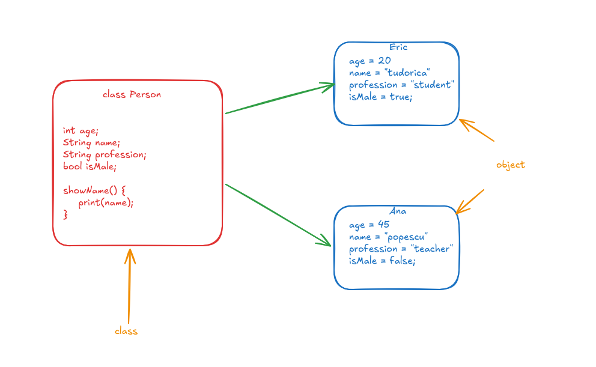
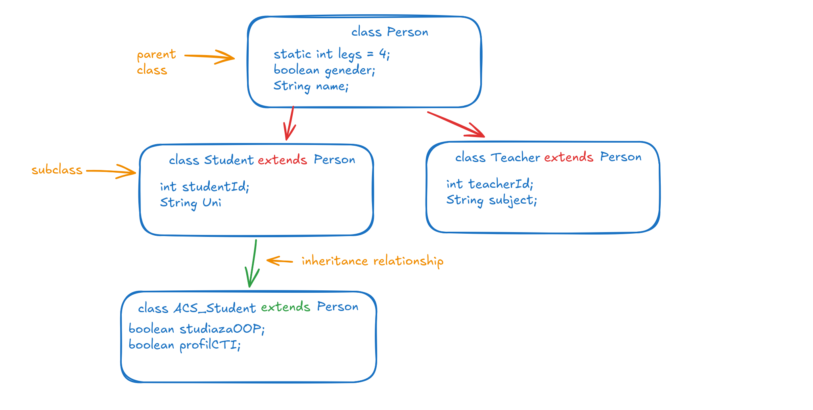

In this article, we will find out more about the **Object-Oriented Programming** paradigm. But first, we need to understand what a programming paradigm is.

## What is a programming paradigm?

A **programming paradigm** (or technique) defines *how programs are decomposed*. Basically, it dictates how you slice the problem you want to solve and what the smaller pieces look like.

The different programming paradigms are divided into two main categories:

* **Imperative paradigms** (*how to achieve a result*) - the programmer gives the computer an **explicit sequence of commands** that change the program's state step by step. Examples: *Procedural* and *Object-Oriented Programming (OOP)*.
* **Declarative paradigms** (*what result is desired*) - the programmer describes the **desired outcome or logic** of a computation without detailing the control flow or state changes. Examples: *Functional* and *Database Programming*.

## More about OOP

**Object-Oriented Programming (OOP)** shifts the fundamental building block of software from algorithms and procedures to **interacting objects**. Rather than writing a chronological sequence of steps that transform passive initial data into a result, OOP organizes a program as a collection of cooperating objects that encapsulate both **state** (*data*) and **behavior** (*methods*).

### History of OOP

OOP emerged because as software systems grew in size and complexity, procedural programming faced difficulties since *data and the functions operating on them were not strictly bound together*. The first OOP language was **Simula**, followed later by languages such as **Smalltalk**, **C++**, and **Object Pascal**. In the 1990s, the OOP paradigm began to be widely accepted and used, marking the appearance of another fundamental language: **Java**.

### Criteria of OOP

A program uses OOP when it meets the following criteria:

1. It is organized as a **collection of cooperating objects**.
2. Each object represents an **instance of a class** (classes are *user-defined abstract data types*).
3. Classes are organized into a **class hierarchy** linked via *inheritance relationships*.

### The object model

The **object model** is a conceptual framework that organizes complex software systems into a network of *autonomous, cooperating entities* called **objects**, rather than a flat list of instructions operating on passive data.

## What is OOP?

**Object-Oriented Programming** is a paradigm in which programs are organized as a collection of cooperating objects. It uses **objects rather than algorithms** as its fundamental building blocks.

Each object is an instance of a **class**, and the classes themselves are linked through inheritance, forming a hierarchy. Basically, a class represents a **blueprint** that *consumes no data memory on its own*, defining what data an entity holds and what operations it can perform.

The object model relies on **4 major principles**:

1. **Abstraction**
2. **Encapsulation**
3. **Modularity**
4. **Hierarchy**

---

## Abstraction

**Abstraction** involves ignoring non-essential implementation details in order to **focus on what is essential**. It requires identifying similarities among different entities and focusing on their shared aspects, while also highlighting what makes an object *distinct from others*.

It operates at the **design and conceptual level**, answering the question: *"What does this object represent and what can it do?"*

It is implemented in code via:

* **Interfaces** - *pure method signatures* with zero implementation details (aside from default/static methods in modern Java).
* **Abstract classes** - *partial blueprints* that cannot be instantiated directly. They can contain **abstract methods** (methods without bodies), forcing subclasses to implement them.

---

## Encapsulation

**Encapsulation** enforces **information hiding**, meaning that objects *cannot directly alter the internal state* of other objects. Instead, these operations can only be performed through the object's own methods, which make up its **interface**.

It ensures that structure is separated from behavior—**structure** is hidden inside the internal *implementation*, while **behavior** is exposed through the public *interface*.

To respect encapsulation, member data variables are generally declared with the `private` or `protected` keywords, **restricting direct external access** and making them accessible only through the class's own member functions.

Based on the operation they perform on the manipulated data, these methods are called **getters** (*if they read the data*) or **setters** (*if they modify it*).

**Getter** and **setter** functions provide major advantages such as:

* **Data validation** - before modifying the data, the new state can be validated.
* **Implementation independence** - due to the limited entry points to the data, we can change the *internal implementation* easily without affecting external code, as long as the method signatures remain the same.
* **Read-only properties** - achieved simply by *not providing setters*.

### Abstraction vs. Encapsulation

* **Abstraction** is applied primarily during the **design and architecture phase**, stripping away irrelevant technical details so that the consumer only interacts with a *clean, high-level model*.
* **Encapsulation** occurs at the **code and implementation phase**, bundling data attributes and functions into a *single unit (the class)* while actively restricting direct access to its internal structure.

---

## Modularity

**Modularization** is the process of partitioning a program into individual components called **modules**. It reduces complexity by establishing *well-defined boundaries* within the program.

It is implemented by grouping related classes and interfaces into units such as *packages* or *modules*. This allows **separate compilation** and makes teamwork easier (each team can work independently on different packages).

Two principles lie at the foundation of modularity:

* **High cohesion** - everything inside a package should be *closely related* and focused on a **single domain**.
* **Loose coupling** - modules should *depend on each other as little as possible*, communicating only through **stable, well-defined APIs**.

---

## Hierarchy

**Hierarchization** is the method of ordering abstractions into structured levels. There are two primary types of hierarchies:

* **Type relationships** - defined through *inheritance between classes*, where a derived class inherits the structure and behavior of a base class.
* **Aggregation relationships** - defined by *dividing a complex object* into multiple simpler objects.

These two types are commonly known as **"IS-A"** vs. **"HAS-A"** hierarchies. The differences can be seen in the following table:

| Feature | Type hierarchy (IS-A) | Aggregation hierarchy (HAS-A) |
| :--- | :--- | :--- |
| **Mechanism** | **Inheritance** (`extends` in Java) | **Object composition** (a complex object is built from simpler objects) |
| **Example** | A dog **is** an animal | A dog **has** 4 legs |
| **Binding time** | **Static** (*compile time*) | **Dynamic** (*components can be swapped at runtime*) |

## Inheritance

**Inheritance** enables the construction of new classes (called **derived classes** or *subclasses*) that retain the characteristics and behavior (member data and functions) of a previously defined class (called a **base class** or *superclass*).

Core advantages include:

* **Code reuse** - avoiding duplicated logic across related classes.
* **Structural organization** - facilitating *polymorphism* and cleaner class hierarchies.

Java only allows **single class inheritance**, meaning that a derived class can only have *one direct base class*. It is declared using the `extends` keyword.

### The `protected` keyword

In Java, if we define a member in a base class using the `private` keyword, **no derived class can directly access** that private member. If we want to **allow subclasses** (and classes within the same package) to access parent members while still *restricting external classes*, we use the `protected` keyword instead.

### The `super` keyword

In Java, to refer to the **immediate parent class**, we use the `super` keyword. Furthermore, to invoke the **parent's constructor**, we call `super()`.

---

## Other OOP principles

### Function overloading

**Function overloading** means that a function executes **different operations depending on the context** in which it is used (for example, the `+` operator in Java performs *addition* for numbers, but *concatenation* for strings).

Practically, multiple functions can share the **exact same name within the same scope**, provided they can be differentiated by the **number or data types of their arguments**. For example, `int abs(int)` and `double abs(double)` are differentiated by their parameter type (`abs(1)` calls the `int` version, while `abs(1.0)` calls the `double` version).

> **Important:** Functions *cannot* be overloaded based solely on their **return types**.

### Polymorphism

In its strict sense, **polymorphism** is the property of a function that can execute the **exact same effect** on values of **different data types**. An example is the `&` operator in C, which extracts the memory address from an `int`, `double`, `char`, or `struct` variable alike.

In broader OOP practice, polymorphism is treated as a core pillar divided into two categories:

* **Compile-time polymorphism** (*static*) - achieved through *function/operator overloading* and *generics/templates* (`<>`).
* **Runtime polymorphism** (*dynamic*) - achieved through *inheritance* and *method overriding*.

### Method overriding

**Method overriding** provides the ability to **redefine inherited methods** specifically for derived (child) classes. Unlike overloading, an overridden method must have the **exact same name, parameter types, and return type** (or a covariant return type).

It strictly **requires inheritance**, and in Java, overriding should be signaled using the `@Override` annotation above the child method. A subclass can also invoke the parent's original overridden method using the `super.methodName()` syntax.