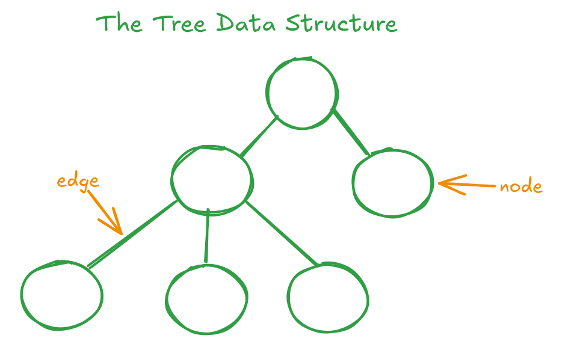
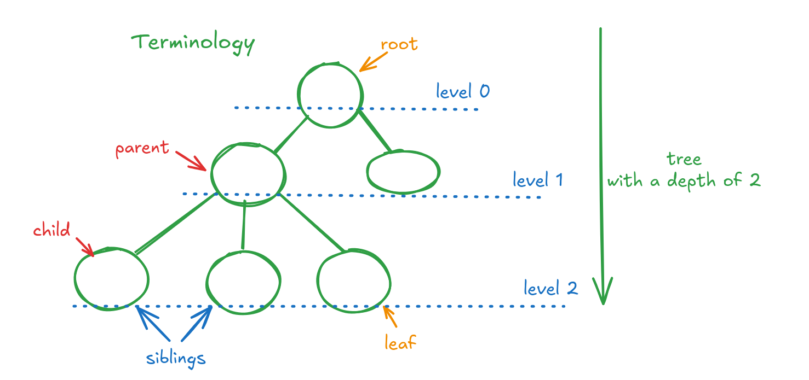

## What is a tree

Ierarhic data structure that is organized as a collection of **nodes**
who are united through **edges**. There is only one edge between whatever
two nodes in the tree.

There are *two types of trees*:
    - binary trees - every node has at *most 2 children nodes*. Examples:
    binary search trees, AVL trees etc.
    - multi-way trees - a node can have *more than 2 children nodes*. Examples:
    trie, 2-3-4 trees etc.

### Terminology

- **root** - the first node in the tree
- **parent** - any node that has at least one node linked directly beneath it
- **child** - a node that stems from another node immediately above it
- **siblings** - nodes that share the same parent
- **subtree** - smaller, independent tree formed by selecting any node withing the main tree and 
including all its descendents
- **leaf** - a node located at the bottom of the structure that has no descendants
- **path** - continuous sequence of nodes and edges that must be traversed from starting node
to the destination
- **degree** - number of direct children a specific nodes has
- **depth** (level) - calculated from the top down, represents the distance from the root to a specific node. The root
is at depth 0

---

# Binary tree

It is a type of tree in which every nodes has maximum two children. Based on the position, we call them
the **left child** and the **right child**.

## Types of binary trees

### Full binary tree

- each node has either 0 or 2 children \<=\> each intern node has 2 children
- it has N internal nodes and N + 1 external nodes
- it has 2*N edges

### Completed tree

- every node has two children expect the ones on the last level that have none

### Binary Search tree

- every node has associated a key
- the keys of the children of an internal node are organized as so:
    - the left child's key is bigger or equal than the parent's key
    - the right child's key is less or equal than the parent's key

### Unequal tree

- the majority of nodes are situated on one part of the root
- the disbalance can come from the order of insertions